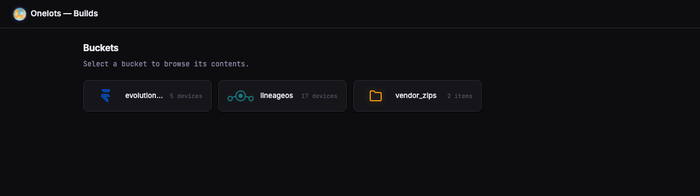
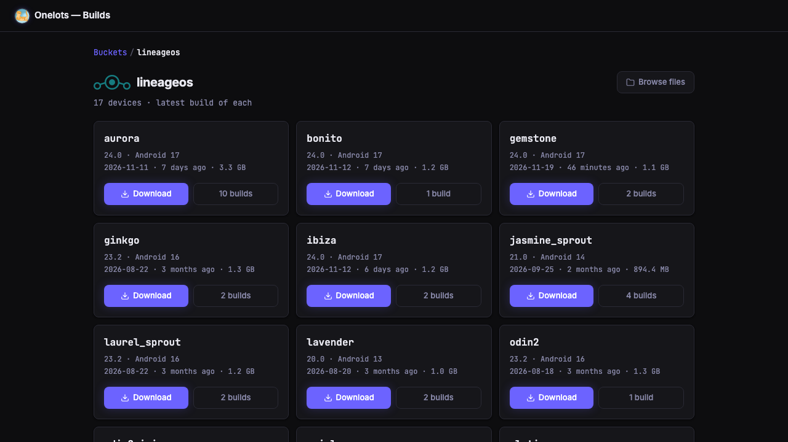
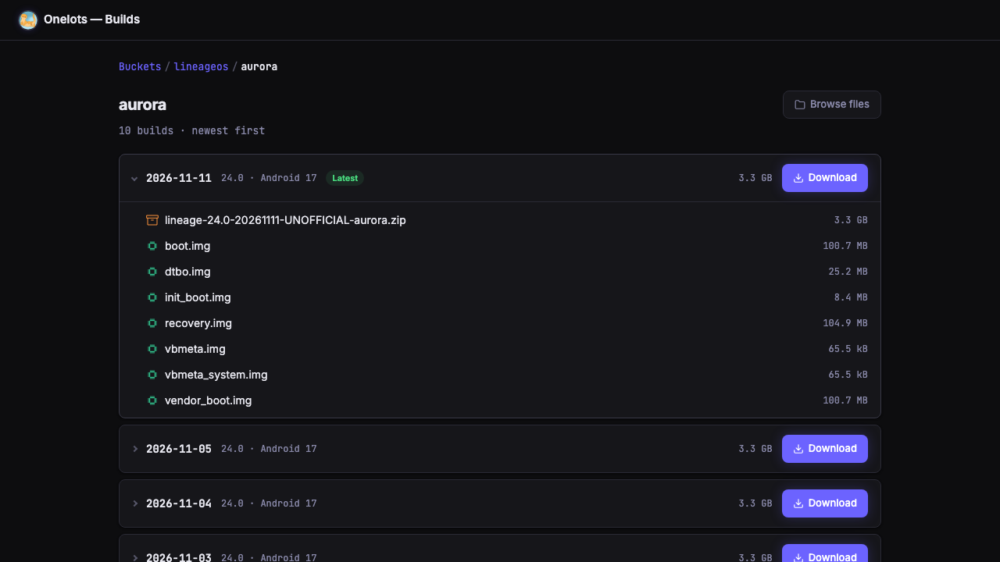

# bucket_browser

The download site behind [downloads.onelots.org](https://downloads.onelots.org): a Flask app serving the
Onelots builds bucket.

## Features

- **Device catalog**: each ROM lists the latest build of every device, with its build history.
- **File browser**: breadcrumb navigation, recursive search and pagination for everything else.
- **Downloads**: files redirect to 1-hour presigned URLs, `.json` files are served directly for OTA clients.
- **ROM logos**: drop a `s3_web_browser/static/rom-<folder>.png` to show it on the home page.

Builds are detected from the bucket layout `<rom>/<device>/<android>/<version>/<YYYYMMDD>/<file>`.
Listings are cached in memory for a minute.

## Configuration

All configuration is done via environment variables (or a `.env` file):

| Variable | Default | Description |
|---|---|---|
| `AWS_ACCESS_KEY_ID` | — | S3 access key |
| `AWS_SECRET_ACCESS_KEY` | — | S3 secret key |
| `AWS_DEFAULT_REGION` | `eu-central-1` | S3 region |
| `AWS_ENDPOINT_URL` | — | Custom S3 endpoint |
| `DEBUG` | `False` | Flask debug mode |
| `PAGE_ITEMS` | `300` | Items per page |

See `.env.example` for a template.

## Run

1. Create a `.env` file with your credentials (see `.env.example`).
1. `docker compose up -d --build`
1. Open http://127.0.0.1:8000/

## Development

1. Install dependencies: `make install`
1. Run code quality checks: `make cq`
1. Run tests: `make test`
1. Start the app: `poetry run python run.py`

## License

MIT, see the LICENSE file. Forked from [romanzdk/s3-web-browser](https://github.com/romanzdk/s3-web-browser).
